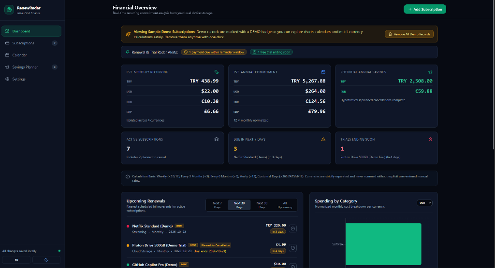

# RenewRadar — Subscription & Renewal Tracker

**RenewRadar** is a privacy-first, local-only personal finance web application for tracking recurring subscriptions, upcoming renewal dates, expiring free trials, multi-currency commitments, and hypothetical cancellation savings.

Built with **React 18**, **TypeScript**, **Vite**, **Tailwind CSS**, **Recharts**, **Lucide Icons**, and **IndexedDB (`idb`)**, RenewRadar runs 100% in the browser without accounts, servers, analytics, or paid APIs.

---

## Features

- **Currency-Isolated Financial Dashboard**:
  - Tracks **TRY**, **USD**, **EUR**, and **GBP** in strict isolation—different currencies are never inaccurately summed together.
  - Displays estimated monthly recurring spending, annualized commitment, active subscription count, payments due in the next 7 days, free trials ending within 14 days, and hypothetical annual savings.
  - Supports optional **User-Provided Manual Exchange Rates** (clearly labeled with context/date and never presented as live market rates).
- **Deterministic 12-Month Cash-Flow & Category Visualizations**:
  - Interactive **Spending by Category** breakdown per currency.
  - Deterministic **12-Month Cash-Flow Projection** based on actual renewal dates and billing intervals, with a toggle to stop projecting subscriptions after their planned cancellation date.
- **Complete Subscription Lifecycle (CRUD)**:
  - Create, edit, duplicate, archive, restore, and delete subscriptions with confirmation dialogs.
  - Advance a subscription's billing cycle with **Advance Cycle (Paid)** and immediately **Undo** if needed.
  - Supports Weekly, Monthly, Every 3 Months, Every 6 Months, Yearly, and Custom (`d` days) billing intervals.
- **Timezone-Safe Monthly Calendar & Mobile Agenda**:
  - Pure calendar-date (`YYYY-MM-DD`) arithmetic handles month boundaries (`Jan 31 → Feb 28/29 → Mar 31`) and leap years without UTC/local timezone off-by-one shifts.
  - Inspect daily scheduled renewals, trial expirations, and currency-grouped daily totals.
  - Includes a dedicated **Monthly Renewal Agenda** list view on mobile screens.
- **Savings Planner**:
  - Flag active subscriptions as **Planned for Cancellation** with an optional target cancellation date.
  - Clearly distinguishes current active spending (which still includes planned cancellations until actually cancelled) from hypothetical future spending and annualized savings.
  - Mark cancellations as completed locally while preserving records in the **Cancelled & Archived History**.
- **Search, Multi-Filter & Sorting**:
  - Combine search (by service name, notes, or payment label) with Category, Status, Currency, Billing Interval, and Renewal Window filters.
  - Sort by Nearest Renewal Date, Monthly Cost, Name, or Recently Updated.
- **Validated JSON Backup, Restore & Single-Record Export**:
  - Export your entire library or individual subscription records as JSON.
  - Validate backup schema (`v1`) and preview record counts and duplicate IDs before importing in **Merge** (`update_existing` or `keep_both`) or **Replace** mode.
- **Full Localization & Theme System**:
  - Complete **English (`EN`)** and **Turkish (`TR`)** interface localization.
  - **Dark** (default slate financial theme), **Light**, and **System** theme modes.
- **Safe Demo Mode**:
  - First-time visitors can load clearly badged (`DEMO`) sample records and remove them anytime with a single click without affecting real user data.


---

## Screenshots



---

## Architecture Overview

```
renew-radar/
├── .github/workflows/deploy.yml   # CI/CD pipeline: runs Vitest + Vite build + GitHub Pages deploy
├── public/favicon.svg             # Vector application icon
├── src/
│   ├── components/
│   │   ├── ConfirmDialog.tsx          # Accessible confirmation modal for destructive actions
│   │   ├── NotificationBanner.tsx     # In-app overdue, upcoming renewal & trial reminder bar
│   │   └── SubscriptionFormModal.tsx  # Validated Add/Edit subscription modal
│   ├── context/
│   │   └── AppContext.tsx             # State orchestration, IndexedDB sync, undoable actions
│   ├── i18n/
│   │   └── translations.ts            # Complete English (en) & Turkish (tr) dictionary
│   ├── pages/
│   │   ├── CalendarPage.tsx           # Desktop monthly grid + mobile agenda + daily inspector
│   │   ├── DashboardPage.tsx          # Metrics, upcoming renewals, Recharts visualizations
│   │   ├── SavingsPage.tsx            # Cancellation planner & hypothetical savings breakdown
│   │   ├── SettingsPage.tsx           # Localization, manual exchange rates, JSON import/export
│   │   └── SubscriptionsPage.tsx      # Searchable, multi-filtered subscription table
│   ├── services/
│   │   └── storage.ts                 # Versioned IndexedDB wrapper (`idb`) + fallback storage
│   ├── types/
│   │   └── subscription.ts            # Core TypeScript domain models
│   └── utils/
│       ├── backupUtils.ts             # JSON schema validation, duplicate ID resolution, merge/replace
│       ├── calculations.test.ts       # Comprehensive Vitest unit test suite
│       ├── dateUtils.ts               # Timezone-safe YYYY-MM-DD math, leap years, month-end clamping
│       ├── demoData.ts                # Isolated sample dataset generator
│       └── financeUtils.ts            # Normalization formulas, currency isolation, 12m projection
```

### Financial Normalization Formulas

For a subscription with billing amount $A$:

- **Weekly**: $\text{Monthly Estimate} = \frac{A \times 52}{12}$
- **Monthly**: $\text{Monthly Estimate} = A$
- **Every 3 Months**: $\text{Monthly Estimate} = \frac{A}{3}$
- **Every 6 Months**: $\text{Monthly Estimate} = \frac{A}{6}$
- **Yearly**: $\text{Monthly Estimate} = \frac{A}{12}$
- **Custom Interval ($d$ days)**: $\text{Monthly Estimate} = \frac{A \times 365.2425}{d \times 12}$
- **Annual Estimate**: $\text{Annual Estimate} = \text{Monthly Estimate} \times 12$

---

## Privacy & Security Model

1. **100% Local Persistence**: All subscriptions and user preferences are stored locally in your browser's IndexedDB (`renewradar_db`, Schema `v1`).
2. **Zero Telemetry or Network Calls**: No analytics scripts, no tracking pixels, no authentication servers, and no external API requests are ever made.
3. **No Payment Secrets**: The optional payment method field only stores a user-defined nickname (e.g., `"Virtual Visa ••4821"`). Full card numbers, CVV codes, or banking credentials are never requested or stored.
4. **Strict Input & Import Sanitization**:
   - Imported JSON backups are strictly validated against schema rules before preview or import.
   - Provider URLs are validated with `new URL()` and restricted to `http:` or `https:` protocols (`javascript:` and `data:` URIs are rejected).
   - Notes and labels are rendered as escaped React text nodes—never injected via `dangerouslySetInnerHTML` or `eval`.

---

## Known Limitations

- **Local Browser Storage Scope**: Because RenewRadar has no backend or cloud account system, data is not automatically synchronized across different devices or browsers. Clearing your browser's site data will erase local records unless you have exported a JSON backup from **Settings**.
- **Notification Scope**: In-app reminder banners appear automatically whenever the application is open. Optional browser notifications can only fire while the browser process is open and cannot wake a closed browser without a push server.
- **Local Tracking Only**: Marking a subscription as *Planned for Cancellation* or *Cancelled* updates your local RenewRadar records only; you must still cancel the billing agreement directly with your service provider.

---

## Local Development & Testing

### Prerequisites

- **Node.js** 18+ (tested with Node 20 / 24) and **npm**

### Commands

```bash
# 1. Install dependencies
npm install

# 2. Start local development server
npm run dev

# 3. Run unit tests (Vitest)
npm test

# 4. Build production bundle (TypeScript check + Vite build)
npm run build

# 5. Preview production bundle locally
npm run preview
```

---

## Deploying to GitHub Pages

RenewRadar is preconfigured for zero-config deployment to GitHub Pages under any repository name:

1. Push this repository to GitHub (default branch: `main`).
2. In your GitHub repository, navigate to **Settings → Pages**.
3. Under **Build and deployment → Source**, select **GitHub Actions**.
4. The workflow in `.github/workflows/deploy.yml` will automatically:
   - Install dependencies (`npm ci`)
   - Execute the unit test suite (`npm test`)
   - Dynamically configure `VITE_BASE_PATH` for your repository name (`/<repo-name>/` or `/` for `<username>.github.io`)
   - Build the production bundle (`npm run build`) and deploy `./dist` to GitHub Pages.

---

## License

Released under the [MIT License](./LICENSE).
